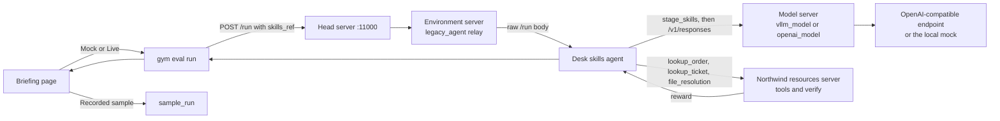

# Northwind support desk: a NeMo Gym Agent Skills demo

A support lead can watch this in five minutes. The same five customer tickets are scored three times: with no operational skills, with the full skill set, and with the refund skill removed. NeMo Gym records a reward for every ticket. The comparison is the point.

Open the briefing page if you are presenting without a terminal. It loads the recorded sample immediately, and it can also start the real NeMo Gym run.

```bash
./run_ui.sh
```

Then open http://127.0.0.1:43123. `make ui` is the same command. The page listens on `$PORT` when that variable is set, which is what Railway does.

The first time you run the terminal demo, NeMo Gym builds a virtualenv for each server. That can take several minutes. After that, the three evaluations themselves are short. If you are about to walk into the room and the servers are still installing, stay on Recorded sample in the briefing page, or open [sample_run/comparison.md](sample_run/comparison.md). That folder is a recorded mock run, labeled as such.

## What NeMo Gym is

[NeMo Gym](https://github.com/NVIDIA-NeMo/Gym) evaluates agents in an environment. You give it tasks, an agent, and a verifier. It runs each task, asks the environment for a reward, and writes the rollouts to a JSONL file.

This demo uses NeMo Gym **0.7.0** from PyPI. It does not need a GPU. The policy model is an OpenAI-compatible HTTP endpoint. With no API key, a local mock answers in the same shape so the Gym path still runs.

## What Agent Skills are, and why they matter

An Agent Skill is a directory with a `SKILL.md` file. The file starts with YAML frontmatter (`name`, `description`) and then the instructions. Extra files, such as a rate card, live next to it. The open spec is [agentskills.io](https://agentskills.io/specification). NeMo Gym's contract is documented at [Agent Skills](https://docs.nvidia.com/nemo/gym/agent-server/agent-skills).

NeMo Gym does **not** read the skill and paste it into the prompt. A skill directory is a run-level knob:

```bash
gym eval run --no-serve --agent northwind_desk_skills_agent \
  --input resources_servers/northwind_desk/data/tasks.jsonl \
  --output results/full_skills.jsonl \
  +skills.path=skills/full
```

The same JSONL is used for every variant. Nothing in the task file says which skills exist. Gym stamps a `skills_ref` on the `/run` body (`path`, a 12-character content hash, and each skill's name and description). The agent is responsible for the rest:

1. Read `skills_ref["path"]`.
2. Copy the directory with `nemo_gym.skills.stage_skills` into a per-request folder.
3. Discover the skills the way the spec describes: name and description first, the full `SKILL.md` only when the model activates the skill, and a referenced file only when the instructions ask for it.

That last step is why skills are useful to a leadership audience. The model is not handed the whole policy manual on every ticket. It is told which playbooks exist, and it has to open the right one. Take the playbook away and the score drops, even though the tickets and the tools did not change.

The built-in Claude Code and Codex agents do step 3 with those products' own skill folders. `simple_agent` ignores skills. This demo's desk agent is a small OpenAI-compatible adapter that does the three steps above, so the demo can point at NVIDIA's API catalog or OpenAI without those CLIs.

## The story

Northwind Outfitters runs a support desk. An associate gets one ticket, looks up the order and the ticket, and files a single resolution. The tools return facts. They do not return the company rule.

Three skills live in [skills/full](skills/full):

| Skill | What it teaches |
| --- | --- |
| `escalation-playbook` | Safety flags and merchandise over $200 go to a person. Check this before any refund. |
| `refund-policy` | Ordinary refunds. The windows, the 70 percent damage rate, and the disposition codes are only in `references/rate-card.md`. |
| `close-the-ticket` | Look up the order and the ticket before filing. Use the exact `file_resolution` fields. |

`skills/without_refund_policy` is the same set with `refund-policy` removed. The demo regenerates it from the full set at the start of every run, so the two copies of the shared skills cannot drift.

Five tickets, each of which wants a different rule:

| Ticket | What is going on | Correct outcome |
| --- | --- | --- |
| T-441 dented kettle | Opened, damaged in transit, day 9, $80 merchandise | `damage_window_partial`, refund $56.00, no escalation |
| T-442 jacket | Still sealed, day 20, $120 | `full_refund_unopened`, refund $120.00 |
| T-443 shoes | Worn, day 40, gold customer | `goodwill_replacement`, refund $0 |
| T-444 blender | Customer reports a shock. Safety flag is on the ticket, not in the email. | `escalate_safety`, refund $0, escalate |
| T-445 tent | Still sealed, but merchandise is $260. The price is not in the email. | `escalate_high_value`, refund $0, escalate |

The customer's message never contains the disposition code, the 70 percent, or the $200 line. A model that only reads the email cannot know them.

The verifier scores the last `file_resolution` call:

- **procedure** is 1 when the agent looked up this order and this ticket before filing.
- **decision** is 1 when the disposition, the refund (within a tenth of a cent), and the escalate flag match the policy.
- **reward** is `0.4 * procedure + 0.6 * decision`.

A busy agent that looks things up and then guesses the money still loses most of the point. Wrong answers are real scores. They are not masked out.

## Architecture



`vllm_model` is the adapter for chat-completions endpoints, including `https://integrate.api.nvidia.com/v1`. It translates Gym's Responses API to `POST {base_url}/chat/completions`. `openai_model` posts to `{base_url}/responses` and is the one to use for OpenAI's Responses API. Pointing `openai_model` at a chat-only host returns 404.

## Setup

Python 3.13.14 and [uv](https://docs.astral.sh/uv/) are required. NeMo Gym 0.7.0 installs them into `.venv` on the first run. No GPU.

```bash
cp .env.example .env
# Leave POLICY_API_KEY empty to use the mock.
# Or set a real key, base URL, and model. Never commit .env.
./run_demo.sh
```

`make demo` is the same command. `make ui` starts the briefing page. `make test` runs the unit tests only.

The script writes `env.yaml` from the environment. That file holds the API key, is gitignored, and is regenerated on every run.

## What the one command does

1. Creates `.venv` and installs `nemo-gym==0.7.0` if needed.
2. Regenerates the five-task JSONL and the missing-skill directory.
3. Runs the unit tests.
4. Starts the mock on port 43117 when no API key is set, or uses your endpoint.
5. Starts the head server, the resources server, the desk agent, the model server, and the environment-server relay. The first start installs a virtualenv per server under `.gym_venvs/`.
6. Waits until `http://127.0.0.1:11000/readyz` returns success.
7. Runs the five tickets three times and writes `results/`.
8. Prints the comparison table and a trace of the dented-kettle episode.

`NEMO_GYM_EXTRA_ROOTS` is set to the repo root before the servers start. The agent process's working directory is its own server folder, so a relative `skills/full` would not resolve there without this. Gym does not set it for a wheel install.

## Walkthrough, if you want to narrate the files first

1. Open [skills/full/refund-policy/SKILL.md](skills/full/refund-policy/SKILL.md). The frontmatter says when to use the skill. The body says to read the rate card. It does not contain the numbers.
2. Open [skills/full/refund-policy/references/rate-card.md](skills/full/refund-policy/references/rate-card.md). The windows, the percent, and the disposition codes are here.
3. Open one line of [resources_servers/northwind_desk/data/tasks.jsonl](resources_servers/northwind_desk/data/tasks.jsonl). The user message is the customer's email. The tools are lookups and `file_resolution`. There is no answer key.
4. Run `./run_demo.sh` (or `make demo`).
5. Read `results/comparison.md`, then `results/trace.md`.

## Briefing page

`./run_ui.sh` serves one page from the same repository. Nothing in the browser asks for an API key.

The page has four parts:

1. The three skills, which you can open, including the refund rate card.
2. The five tickets, with the handoff the associate sees and the outcome the policy requires.
3. **Run demo**, which scores the tickets three times and draws the comparison. While a Gym run is in progress the page shows which step it is on.
4. An episode trace. Pick a ticket and step through it: skill opened, rate card read, order and ticket looked up, resolution filed, reward.

Screenshots of that page are in [docs/screenshots/](docs/screenshots/).

The mode selector has three settings:

| Mode | What it does |
| --- | --- |
| Recorded sample | Replays [sample_run/](sample_run/) immediately. Always available. Labeled as mock output. |
| Mock model | Starts NeMo Gym and the local `mock-desk-associate` model, then scores the five tickets three times. Labeled as not a live model. |
| Live model | Enabled only when the server process already has `POLICY_API_KEY`, `POLICY_BASE_URL`, and `POLICY_MODEL_NAME` (or `POLICY_MODEL`). The page shows the model name and the host. It does not show the key, and it has nowhere to type one. |

Recorded sample is what you want on screen when you walk into the room. Mock model is the same pipeline as `./run_demo.sh` without a key. Live model is that pipeline pointed at your endpoint. The CLI still works, and it does not overwrite `sample_run/`.

Run one Gym collection at a time. The briefing page and `./run_demo.sh` both use port 11000.

## Five-minute talk track

Use the briefing page. The terminal walkthrough above is the same story if you want to show the files.

**0:00.** The table is already on screen. "This is NeMo Gym scoring a support agent. Same tickets, same tools, same grader. The only thing we change is which playbooks the agent is allowed to open. These numbers are the recorded sample, from the mock associate, so we are not waiting on a network."

**0:40.** Open the three skills. "The refund numbers are not in the handoff. They are in the rate card. The model sees the name of the playbook first, and the rate card only if it opens it."

**1:30.** Select ticket T-444. "The handoff says the blender shocked them. The safety flag is a field on the ticket. The tent is the same kind of surprise: the price is on the order, not in the note."

**2:20.** Leave the mode on Recorded sample and hit Run demo if you only need to reload the table. Switch to Mock model if you want the room to watch NeMo Gym score the tickets. Say out loud that the mock is not NVIDIA or OpenAI. Switch to Live model only when the server was started with a key.

**3:20.** Read the three averages. "Without the playbooks the associate still looks up the order and the ticket, so each ticket keeps 0.4, and every decision is wrong. With the skills, every ticket matches. Reward is 1. Take only the refund skill away and the two escalation tickets still pass. The three ordinary refunds fail."

**4:20.** Open the dented-kettle trace on Full skills and press Next. "The associate opens the escalation playbook, opens the refund skill, reads the rate card, looks up the order, and files a $56 partial refund. The verifier agrees. The skills hash is Gym's record of which files were on the run."

**4:50.** "To change the policy, we edit the skill and the verifier together. The tickets stay the same, so the comparison stays fair."

## Deploy to Railway

The container is one service. It binds `0.0.0.0:$PORT` (Railway sets `PORT`; the image default is 8080), serves the briefing page, and answers `GET /health`. `railway.json` sets the start command to `python -m web` and the health check path to `/health`. With no environment variables, Recorded sample works immediately. Mock model works too: the first run installs NeMo Gym's server virtualenvs, which needs outbound network and a few minutes. Later runs reuse them. Live model turns on only when the variables below are set on the service.

Those server virtualenvs are not baked into the image. Prebuilding them copied Ray and the model server's dev extra and made the image too large for a typical Railway deploy. Recorded sample does not start Ray or install anything.

Give the service at least 2 GB of memory before you use Mock model or Live model. Ray starts with those modes. If Ray cannot stay up, the page says so and Recorded sample still loads.

### Railway CLI, from this repository

```bash
railway up
```

That builds the Dockerfile and deploys it. The CLI signs you in if it needs to, and it creates a project when you do not already have one linked. When the deploy is healthy, attach a public URL:

```bash
railway domain
```

Open that URL. `GET /health` should return `{"status":"ok"}`.

### GitHub

1. Push this repository to GitHub.
2. In [Railway](https://railway.com), create a project and choose **Deploy from GitHub repo**. Select the repository and the branch.
3. Railway reads `railway.json`, builds the Dockerfile, and starts `python -m web`. The health check path is `/health`.
4. Generate a domain on the service. Open it.

Set variables in the Railway service settings, not in the browser. Leave them empty to present from the recorded sample.

| Variable | What to put |
| --- | --- |
| `POLICY_API_KEY` | Secret for the endpoint. Empty, or a placeholder such as `changeme`, keeps Live model off. |
| `POLICY_BASE_URL` | For the NVIDIA API catalog: `https://integrate.api.nvidia.com/v1`. |
| `POLICY_MODEL_NAME` | Model id, for example `meta/llama-3.1-8b-instruct`. `POLICY_MODEL` is accepted as an alias. |
| `POLICY_MODEL_TYPE` | `vllm_model` for chat-completions hosts, including NVIDIA's catalog. `openai_model` for OpenAI's Responses API. The first run of either type installs that adapter's virtualenv and needs network access in the container. |
| `POLICY_REASONING_PARSER` | Leave unset. Set `true` only for a reasoning model behind `vllm_model`. |
| `DEMO_TEMPERATURE` | Optional. Defaults to `0`. |
| `PORT` | Railway sets this. The process binds to it. |

A local image of the same container:

```bash
docker build -t northwind-desk .
docker run --rm --memory=3g --shm-size=256m -p 43123:8080 northwind-desk
```

Open http://127.0.0.1:43123. The process inside the container is on port 8080. To point that container at a live model, pass the variables with `-e` and do not bake them into the image.

## Five-minute talk track (terminal)

**0:00.** "This is NeMo Gym scoring a support agent. Same tickets, same tools, same grader. The only thing we change is which playbooks the agent is allowed to open."

**0:40.** Show the three skills. "The refund numbers are not in the prompt. They are in a file the skill tells the agent to read. That is progressive disclosure: the model sees the name of the playbook first, and the rate card only if it opens it."

**1:30.** Show ticket T-441. "Maya says the kettle arrived dented. She does not say the refund is 70 percent of merchandise, and she does not say shipping is excluded. The safety case is sharper: the email says the blender shocked them, but the safety flag is a field on the ticket. The agent has to look it up."

**2:20.** Run `make demo`, or, if the first-time install is still going, open the recorded table. "Three runs. No skills. All three skills. All skills except the refund policy."

**3:20.** Read the table. "Without the playbooks the agent still looks up the order and the ticket, so it gets partial credit. It then files a generic refund for the full merchandise amount. That is the wrong decision on every ticket, including the safety case. Reward is 0.4 out of 1. With the skills, every ticket matches the policy. Reward is 1. Take only the refund skill away and the two escalation tickets still pass, because that playbook is still there. The three ordinary refunds fail."

**4:20.** Open the dented-kettle trace. "You can see the agent activate the escalation playbook, activate the refund skill, read the rate card, look up the order, and file `damage_window_partial` for $56. The verifier agrees. The `skills_ref` hash is Gym's record of exactly which files were on this run."

**4:50.** "To change the policy, we edit the skill and the verifier together. The task file stays the same, so the comparison stays fair."

## How to extend it with a new skill

1. Add `skills/full/shipping-refund/SKILL.md` with `name: shipping-refund` matching the directory, a description that says when to use it, and `metadata.version`.
2. Put any numbers in `references/`, and point the `SKILL.md` body at that file. Keep the numbers out of the description. The description is the only text the agent sees before it activates the skill.
3. Teach [resources_servers/northwind_desk/policy.py](resources_servers/northwind_desk/policy.py) the same rule in `decide`, and add a ticket to `CASES` whose user text does not reveal the new number.
4. The next `./run_demo.sh` regenerates `tasks.jsonl` and the missing-skill variant. Add an assertion in [tests/test_demo.py](tests/test_demo.py) for the new ticket.
5. If the mock should follow the new skill, teach [demo/mock_model.py](demo/mock_model.py) to read the new file the same way it reads the rate card. The mock parses skill text. It does not import `policy.decide`. A skill you forget to load changes the score.

## Recorded sample

[sample_run/](sample_run/) is a completed mock run committed so a presentation still has a table if the live call fails. The manifest names the model `mock-desk-associate` and NeMo Gym 0.7.0. It is not output from NVIDIA or OpenAI.

A live run with your key writes `results/` and does not overwrite `sample_run/`.

## Tests

`make test` covers the policy, the skill files, path checks on `read_skill_file`, the mock's with-and-without-skills behavior, the comparison table, the mock HTTP server, and the briefing page's recorded-sample API. Those tests do not start NeMo Gym. `./run_demo.sh` runs them and then the real Gym collection.

## Limitations of this demo, and of NeMo Gym 0.7.0

- Gym stamps `skills_ref` and hashes the directory. It does not select, inject, or activate skills. An agent that does not read `skills_ref` silently runs with no skills. `simple_agent` is that agent.
- The Claude Code and Codex adapters are the ones shipped with Gym. They need those CLIs, and turning skills on for Claude Code drops `--bare`, which re-enables all of that CLI's auto-discovery, not only the skills you staged. This demo does not pretend otherwise. The desk agent is the OpenAI-compatible implementation of the documented three-step adapter.
- On 0.7.0 the helpers are `nemo_gym.skills`. The current docs site describes `nemo_gym.agents.skills`, which is where they moved on the GitHub main branch after the 0.7.0 release. The desk agent tries the newer path and falls back.
- `openai_model` talks to the Responses API. Most "OpenAI-compatible" hosts, including the NVIDIA integrate endpoint, only implement chat completions. Use `POLICY_MODEL_TYPE=vllm_model` for those. `vllm_model` defaults `uses_reasoning_parser` to true, which can rewrite ordinary chat output. The demo turns that off unless `POLICY_REASONING_PARSER=true`.
- A relative `+skills.path` is resolved from the agent process's working directory, then from `NEMO_GYM_EXTRA_ROOTS`. A wheel install does not set that variable for you. The demo exports the repo root.
- Gym 0.7.0 will not accept `+skills.path` on a materialized task row. These tasks are flat `responses_create_params` rows for that reason.
- The first `gym env start` installs server virtualenvs, including NeMo Gym's dev extra for the built-in model server. Later runs reuse `.gym_venvs/`.
- The mock is deterministic and only correct because it parses the skill files. A real model can ignore a skill, misread the rate card, or fail a tool call. That is the measurement you want from a live key, and it will not match the mock table.
- Temperature defaults to 0. Some endpoints reject that. Set `DEMO_TEMPERATURE` in `.env` if yours does.
- Rewards grade the filed decision, not the prose of the customer message.
- The briefing page and `./run_demo.sh` both collect through port 11000. Run one of them at a time.
- Mock model and Live model start Ray inside the same machine as the page. The container limits Ray's object store so a modest service can boot. If Ray still cannot start, the page says so. Recorded sample does not start Ray, and it stays available.
- The image ships the `gym` command and the recorded sample. It does not ship the per-server virtualenvs. The first Mock model or Live model run in a fresh container installs them and needs network access. `vllm_model` and `openai_model` each install their own adapter virtualenv.
- Live model reads `POLICY_API_KEY` from the server environment. The page has no field for a key.
