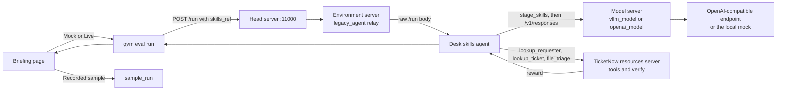

# TicketNow IT service desk: a NeMo Gym Agent Skills demo

An IT support lead can watch this in a few minutes. The same twelve employee tickets are scored three times: with no operational skills, with the full skill set, and with the priority matrix removed. NeMo Gym records a reward for every ticket. The comparison is the point.

Open the briefing page if you are presenting without a terminal. It loads the recorded sample immediately, and it can also start the real NeMo Gym run.

```bash
./run_ui.sh
```

Then open http://127.0.0.1:43123. `make ui` is the same command. The page listens on `$PORT` when that variable is set, which is what Railway does.

The container image already contains the server virtualenvs, so Mock model and Live model on Railway do not spend the first start installing them. A checkout on a laptop still builds those virtualenvs the first time `./run_demo.sh` runs, and that can take several minutes. If you are about to walk into the room, stay on Recorded sample, or open [sample_run/comparison.md](sample_run/comparison.md). That folder is a recorded mock run, labeled as such.

The Railway service name is unchanged. This repository changes the desk the service presents.

## What NeMo Gym is

[NeMo Gym](https://github.com/NVIDIA-NeMo/Gym) evaluates agents in an environment. You give it tasks, an agent, and a verifier. It runs each task, asks the environment for a reward, and writes the rollouts to a JSONL file.

This demo uses NeMo Gym **0.7.0** from PyPI. It does not need a GPU. The policy model is an OpenAI-compatible HTTP endpoint. With no API key, a local mock answers in the same shape so the Gym path still runs.

## What Agent Skills are, and why they matter

An Agent Skill is a directory with a `SKILL.md` file. The file starts with YAML frontmatter (`name`, `description`) and then the instructions. Extra files, such as a priority matrix, live next to it. The open spec is [agentskills.io](https://agentskills.io/specification). NeMo Gym's contract is documented at [Agent Skills](https://docs.nvidia.com/nemo/gym/agent-server/agent-skills).

NeMo Gym does **not** read the skill and paste it into the prompt. A skill directory is a run-level knob:

```bash
gym eval run --no-serve --agent ticketnow_desk_skills_agent \
  --input resources_servers/ticketnow_desk/data/tasks.jsonl \
  --output results/full_skills.jsonl \
  +skills.path=skills/full
```

The same JSONL is used for every variant. Nothing in the task file says which skills exist. Gym stamps a `skills_ref` on the `/run` body (`path`, a 12-character content hash, and each skill's name and description). The agent is responsible for the rest:

1. Read `skills_ref["path"]`.
2. Copy the directory with `nemo_gym.skills.stage_skills` into a per-request folder.
3. Discover the skills the way the spec describes: name and description first, the full `SKILL.md` only when the model activates the skill, and a referenced file only when the instructions ask for it.

That last step is why skills are useful to a leadership audience. The model is not handed the whole policy manual on every ticket. It is told which playbooks exist, and it has to open the right one. Take the priority matrix away and the score drops, even though the tickets and the tools did not change.

The built-in Claude Code and Codex agents do step 3 with those products' own skill folders. `simple_agent` ignores skills. This demo's desk agent is a small OpenAI-compatible adapter that does the three steps above, so the demo can point at OpenAI's Responses API or NVIDIA's API catalog without those CLIs.

## The story

TicketNow runs an IT service desk. A lead gets one employee ticket, looks up the requester and the ticket, and files a single triage. The tools return facts. They do not return the company rule. The intake tag on the ticket, Incident, Request, or Inquiry, is what routing starts from. The employee's wording is not that tag.

Four skills live in [skills/full](skills/full):

| Skill | What it teaches |
| --- | --- |
| `security-first-response` | Check this before anything else. A phishing click, a lost or stolen laptop, and a compromised account are P1 and go to security operations immediately. The codes are in the playbook. |
| `ticket-classification` | Copy the intake tag and category from the ticket, then map the category to an assignment group. The group codes are only here. |
| `access-request-policy` | Access requests need manager approval. A lockout is a credential reset, not a new grant. Offboarding disables accounts the same day and collects equipment. Onboarding provisions both. |
| `priority-matrix` | The priority levels and the 72-hour inquiry threshold are only in `references/priority-matrix.md`. |

`skills/without_priority_matrix` is the same set with `priority-matrix` removed. The demo regenerates it from the full set at the start of every run, so the shared skills cannot drift.

Twelve tickets, each of which wants a different rule. The handoff never contains the priority, the assignment group, or the action codes.

| Ticket | What is going on | Correct outcome |
| --- | --- | --- |
| TKT-2401 GitHub access | Request for an application | Request, P4, Identity and access, manager approval |
| TKT-2402 MFA on a new phone | Sign-in broke. This is an incident, not a new grant | Incident, P3, Identity and access, reset credentials |
| TKT-2403 VPN | Connects, then internal sites fail. Monitoring shows a shared outage | Incident, P2, Network operations, restore service |
| TKT-2404 Mailbox full | Outlook will not send | Incident, P3, Collaboration, restore service |
| TKT-2405 Laptop will not turn on | Hardware is down before a meeting | Incident, P3, Endpoint support, dispatch a technician |
| TKT-2406 Install VS Code | Software request | Request, P4, Application support, fulfill from the catalog |
| TKT-2407 New hire Monday | Joiner needs a laptop and accounts | Request, P3, Lifecycle, provision accounts and a laptop |
| TKT-2408 Offboard Friday | Last day. Disable accounts and collect equipment | Request, P2, Lifecycle, same-day disable and collect equipment |
| TKT-2409 Clicked a suspicious link | Security signal is on the ticket, not spelled out as a code in the note | Incident, P1, Security operations, isolate the session and reset credentials |
| TKT-2410 Laptop left in a rideshare | Same class of security incident | Incident, P1, Security operations, wipe the device and reset credentials |
| TKT-2411 Phone will not enroll | MDM enrollment failed | Incident, P3, Mobile devices, reset enrollment |
| TKT-2412 Three-day escalation | Inquiry. The note says "three days". The ticket has been open 80 hours | Inquiry, P2, Service desk, status update |

The verifier scores the last `file_triage` call:

- **procedure** is 1 when the lead looked up this requester and this ticket before filing.
- **decision** is 1 when the type, category, priority, assignment group, and actions match the policy. Spacing and capitalization are ignored. The action list may be in any order.
- **reward** is `0.4 * procedure + 0.6 * decision`.

A lead who looks things up and then guesses the priority still loses most of the point. Wrong answers are real scores. They are not masked out.

On the recorded mock run the means are:

| Configuration | Mean reward | Correct decisions |
| --- | --- | --- |
| No skills | 0.40 | 0 / 12 |
| All four skills | 1.00 | 12 / 12 |
| Without the priority matrix | 0.50 | 2 / 12 |

The two that still pass without the matrix are the phishing click and the lost laptop. That playbook already names P1 and the security queue. Every other ticket keeps the lookup credit and misses the priority.

## Architecture



`openai_model` posts to `{base_url}/responses` and is the adapter for OpenAI's Responses API, including `gpt-4.1-mini` at `https://api.openai.com/v1`. `vllm_model` is the adapter for chat-completions endpoints, including `https://integrate.api.nvidia.com/v1`. It translates Gym's Responses API to `POST {base_url}/chat/completions`. Pointing `openai_model` at a chat-only host returns 404.

## Setup

Python 3.13 and [uv](https://docs.astral.sh/uv/) are required. NeMo Gym 0.7.0 installs them into `.venv` on the first run. No GPU.

```bash
cp .env.example .env
# Leave POLICY_API_KEY empty to use the mock.
# Or set a real key, base URL, and model. Never commit .env.
./run_demo.sh
```

`make demo` is the same command. `make ui` starts the briefing page. `make test` runs the unit tests only.

The script writes `env.yaml` from the environment. That file holds the API key, is gitignored, and is regenerated on every run.

## What the one command does

1. Creates `.venv` and installs `nemo-gym==0.7.0` if needed.
2. Regenerates the task JSONL and the missing-skill directory.
3. Runs the unit tests.
4. Starts the mock on port 43117 when no API key is set, or uses your endpoint.
5. Starts the head server, the resources server, the desk agent, the model server, and the environment-server relay. The first start on a laptop installs a virtualenv per server under `.gym_venvs/`. The container image already has those virtualenvs.
6. Waits until `http://127.0.0.1:11000/readyz` returns success.
7. Runs the twelve tickets three times and writes `results/`.
8. Prints the comparison table and a trace of the Friday offboarding episode.

`NEMO_GYM_EXTRA_ROOTS` is set to the repo root before the servers start. The agent process's working directory is its own server folder, so a relative `skills/full` would not resolve there without this. Gym does not set it for a wheel install.

## Walkthrough, if you want to narrate the files first

1. Open [skills/full/priority-matrix/SKILL.md](skills/full/priority-matrix/SKILL.md). The frontmatter says when to use the skill. The body says to read the matrix. It does not contain the levels.
2. Open [skills/full/priority-matrix/references/priority-matrix.md](skills/full/priority-matrix/references/priority-matrix.md). The priorities, the 72-hour line, and the security note are here.
3. Open one line of [resources_servers/ticketnow_desk/data/tasks.jsonl](resources_servers/ticketnow_desk/data/tasks.jsonl). The user message is the handoff. The tools are lookups and `file_triage`. There is no answer key.
4. Run `./run_demo.sh` (or `make demo`).
5. Read `results/comparison.md`, then `results/trace.md`.

## Briefing page

`./run_ui.sh` serves one page from the same repository. Nothing in the browser asks for an API key.

The page has four parts:

1. The four skills, which you can open, including the priority matrix.
2. Checkboxes for the playbooks to score. They stay on screen in Recorded, Mock, and Live. A run with no playbooks is always scored beside the ones you leave checked. "Also show these tickets with the priority matrix removed" stays on unless you turn it off. Recorded sample only contains no skills, all four skills, and without the priority matrix. Any other mix asks you to run Mock or Live.
3. **Run demo**, which scores that selection. While a Gym run is in progress the page shows the step and the latest Gym log. If a run is already going, the page attaches to it and says so instead of failing the click.
4. **Walk the ticket.** Pick a ticket from the cards. Each card has the title, an Incident, Request, or Inquiry badge, and a category icon. Then move through five steps with Next, Back, or the arrow keys: Employee request, Skills loaded, Agent decision, Reward check, and Score. The decision and the score put "without skills" beside the playbooks you checked, with a Pass or Miss on each part of the filing. Tool output stays behind "Show technical details".

Screenshots of that page are in [docs/screenshots/](docs/screenshots/). The walk is `walk-request.png`, `walk-decision.png`, and `walk-score.png`. The playbook checkboxes are `skill-picker.png`.

The mode selector has three settings:

| Mode | What it does |
| --- | --- |
| Recorded sample | Replays [sample_run/](sample_run/) immediately. Always available. Labeled as mock output. |
| Mock model | Starts NeMo Gym and the local `mock-it-lead` model, then scores the twelve tickets three times. Labeled as not a live model. |
| Live model | Enabled only when the server process already has `POLICY_API_KEY`, `POLICY_BASE_URL`, and `POLICY_MODEL_NAME` (or `POLICY_MODEL`). The page shows the model name, the host, and the adapter (`openai_model` or `vllm_model`). It does not show the key, and it has nowhere to type one. |

Recorded sample is what you want on screen when you walk into the room. Mock model is the same pipeline as `./run_demo.sh` without a key. Live model is that pipeline pointed at your endpoint. With `POLICY_MODEL_TYPE=openai_model`, `POLICY_BASE_URL=https://api.openai.com/v1`, and `POLICY_MODEL_NAME=gpt-4.1-mini`, Live model is available and the page names that model. The CLI still works, and it does not overwrite `sample_run/`.

Run one Gym collection at a time. The briefing page and `./run_demo.sh` both use port 11000.

## Talk track

The page itself does not carry speaker notes. Use this if you are narrating.

**Open.** "This is NeMo Gym scoring an IT service desk lead at TicketNow. Same twelve tickets, same tools, same grader. The only change is which playbooks the lead is allowed to open. These numbers are the recorded sample, from the mock lead, so we are not waiting on a network."

**Skills.** Open the four skills. "The priority levels are not in the handoff and not in the skill's opening description. They are in the matrix, which the playbook tells the lead to read. Security incidents are named in their own playbook, so they still have an answer when the matrix is gone."

**Tickets.** Select the phishing ticket, then the Friday offboard. "The note says they clicked a link. The security signal is a field on the ticket. The offboard note says Friday. The same-day actions are in the access playbook, and P2 is in the matrix. The three-day inquiry is the same shape: the note says three days, the threshold is 72 hours on the ticket's clock."

**Run.** Leave the mode on Recorded sample, or switch to Mock model if you want the room to watch NeMo Gym score the tickets. Say out loud that the mock is not OpenAI. Switch to Live model only when the server was started with a key. On the deployed desk that key points at `gpt-4.1-mini`.

**Scores.** "Without the playbooks the lead still looks up the requester and the ticket, so each ticket keeps 0.4, and every decision is wrong. With the skills, every ticket matches. Reward is 1. Take only the priority matrix away and the two security incidents still pass. The other ten fail. Mean reward is 0.50."

**Walk.** Open the Friday offboard card. Step through Employee request, Skills loaded, Agent decision, Reward check, and Score. On the decision and the score, the left column had no playbooks and the right column had all four. Green Pass and red Miss sit on each part of the filing. "The lead looks the employee and the ticket up, reads the matrix, and files a P2 lifecycle triage with same-day disable. The verifier agrees. Show technical details if someone asks for the tool list or the skills hash."

**Close.** "To change the policy, edit the skill and the verifier together. The tickets stay the same, so the comparison stays fair."

## Deploy to Railway

The container is one service. It binds `0.0.0.0:$PORT` (Railway sets `PORT`; the image default is 8080), serves the briefing page, and answers `GET /health`. `railway.json` sets the start command to `python -m web` and the health check path to `/health`. The Railway service name is left as it is. With no environment variables, Recorded sample works immediately. Mock model and Live model start NeMo Gym against virtualenvs that the image build already installed, for both `vllm_model` and `openai_model`. Live model turns on only when the variables below are set on the service.

Recorded sample does not start Ray. Gym and Ray write to the container stdout, prefixed `[gym]`, and the full text is kept in the run log. The page and `GET /api/runs/{id}` show the last 200 lines under Show technical details. Ray starts with the dashboard off, two CPUs at most, a 200 MB object store, and the store files on `/tmp` rather than `/dev/shm`, so a 64 MB `/dev/shm` is enough. If Gym stops printing before it is ready, or it is not ready within three minutes when the virtualenvs are present, the page shows the error and that log instead of spinning. A second click while a run is going attaches to that run.

Give the service at least 2 GB of memory before you use Mock model or Live model. Ray starts with those modes. If Ray cannot stay up, the page says so and Recorded sample still loads.

### Railway CLI, from this repository

```bash
railway up
```

That builds the Dockerfile and deploys it. The CLI signs you in if it needs to, and it creates a project when you do not already have one linked. When the deploy is healthy, attach a public URL:

```bash
railway domain
```

Open that URL. `GET /health` should return `{"status":"ok","service":"ticketnow-it-desk",...}`.

### GitHub

1. Push this repository to GitHub. Railway redeploys from `main`.
2. In [Railway](https://railway.com), the existing project already deploys this repository. Do not rename the service.
3. Railway reads `railway.json`, builds the Dockerfile, and starts `python -m web`. The health check path is `/health`.
4. Generate a domain on the service if it does not already have one. Open it.

Set variables in the Railway service settings, not in the browser. Leave them empty to present from the recorded sample.

| Variable | What to put |
| --- | --- |
| `POLICY_API_KEY` | Secret for the endpoint. Empty, or a placeholder such as `changeme`, keeps Live model off. |
| `POLICY_BASE_URL` | For the live desk: `https://api.openai.com/v1`. For the NVIDIA API catalog: `https://integrate.api.nvidia.com/v1`. |
| `POLICY_MODEL_NAME` | For the live desk: `gpt-4.1-mini`. `POLICY_MODEL` is accepted as an alias. |
| `POLICY_MODEL_TYPE` | `openai_model` for OpenAI's Responses API, which is what `gpt-4.1-mini` uses. `vllm_model` for chat-completions hosts, including NVIDIA's catalog. Both adapters' virtualenvs are already in the image. |
| `POLICY_REASONING_PARSER` | Leave unset. Set `true` only for a reasoning model behind `vllm_model`. |
| `DEMO_TEMPERATURE` | Optional. Defaults to `0`. |
| `PORT` | Railway sets this. The process binds to it. |

The image includes the parent virtualenv and the per-server virtualenvs. They share files with hardlinks. A local build of this Dockerfile measured 1.4 GB. The build deletes the dummy `env.yaml` it used to prefetch, so no key is in the image.

A local image of the same container:

```bash
docker build -t ticketnow-it-desk .
docker run --rm --memory=3g --shm-size=256m -p 43123:8080 ticketnow-it-desk
```

Open http://127.0.0.1:43123. The process inside the container is on port 8080. To point that container at a live model, pass the variables with `-e` and do not bake them into the image. For the OpenAI desk:

```bash
docker run --rm --memory=3g --shm-size=256m -p 43123:8080 \
  -e POLICY_API_KEY \
  -e POLICY_BASE_URL=https://api.openai.com/v1 \
  -e POLICY_MODEL_NAME=gpt-4.1-mini \
  -e POLICY_MODEL_TYPE=openai_model \
  ticketnow-it-desk
```

Live model on the page is then available. The key stays in the environment.

## How to extend it with a new skill

1. Add `skills/full/change-window/SKILL.md` with `name: change-window` matching the directory, a description that says when to use it, and `metadata.version`.
2. Put any codes in `references/`, and point the `SKILL.md` body at that file. Keep the codes out of the description. The description is the only text the agent sees before it activates the skill.
3. Teach [resources_servers/ticketnow_desk/policy.py](resources_servers/ticketnow_desk/policy.py) the same rule in `decide`, and add a ticket to `CASES` whose user text does not reveal the new code.
4. The next `./run_demo.sh` regenerates `tasks.jsonl` and the missing-skill variant. Add an assertion in [tests/test_demo.py](tests/test_demo.py) for the new ticket.
5. If the mock should follow the new skill, teach [demo/mock_model.py](demo/mock_model.py) to read the new file the same way it reads the priority matrix. The mock parses skill text. It does not import `policy.decide`. A skill you forget to load changes the score.

## Recorded sample

[sample_run/](sample_run/) is a completed mock run committed so a presentation still has a table if the live call fails. The manifest names the model `mock-it-lead` and NeMo Gym 0.7.0. It is not output from OpenAI or NVIDIA.

A live run with your key writes `results/` and does not overwrite `sample_run/`.

## Tests

`make test` covers the policy, the skill files, path checks on `read_skill_file`, the mock's with-and-without-skills behavior, the comparison table, the mock HTTP server, and the briefing page. The page tests check that Live mode stays off without a key and turns on for `openai_model` at `https://api.openai.com/v1` with `gpt-4.1-mini`. Those tests do not start NeMo Gym and do not call OpenAI. `./run_demo.sh` runs them and then the real Gym collection.

## Limitations of this demo, and of NeMo Gym 0.7.0

- Gym stamps `skills_ref` and hashes the directory. It does not select, inject, or activate skills. An agent that does not read `skills_ref` silently runs with no skills. `simple_agent` is that agent.
- The Claude Code and Codex adapters are the ones shipped with Gym. They need those CLIs, and turning skills on for Claude Code drops `--bare`, which re-enables all of that CLI's auto-discovery, not only the skills you staged. This demo does not pretend otherwise. The desk agent is the OpenAI-compatible implementation of the documented three-step adapter.
- On 0.7.0 the helpers are `nemo_gym.skills`. The current docs site describes `nemo_gym.agents.skills`, which is where they moved on the GitHub main branch after the 0.7.0 release. The desk agent tries the newer path and falls back.
- `openai_model` talks to the Responses API. Most "OpenAI-compatible" hosts, including the NVIDIA integrate endpoint, only implement chat completions. Use `POLICY_MODEL_TYPE=vllm_model` for those. `vllm_model` defaults `uses_reasoning_parser` to true, which can rewrite ordinary chat output. The demo turns that off unless `POLICY_REASONING_PARSER=true`.
- A relative `+skills.path` is resolved from the agent process's working directory, then from `NEMO_GYM_EXTRA_ROOTS`. A wheel install does not set that variable for you. The demo exports the repo root.
- Gym 0.7.0 will not accept `+skills.path` on a materialized task row. These tasks are flat `responses_create_params` rows for that reason.
- On a laptop, the first `gym env start` installs server virtualenvs. Later runs, and the container image, reuse `.gym_venvs/`. The page waits up to three minutes when those virtualenvs are already present, and up to five minutes when they are not. A prepared image that stops printing for 90 seconds is reported as failed, with the log tail on the page.
- The mock is deterministic and only correct because it parses the skill files. A real model can ignore a skill, misread the matrix, or fail a tool call. That is the measurement you want from a live key, and it will not match the mock table.
- Temperature defaults to 0. Some endpoints reject that. `gpt-4.1-mini` accepts 0. Set `DEMO_TEMPERATURE` in `.env` if yours does not.
- Rewards grade the filed triage, not the prose of the employee message. The grader accepts a different capitalization and a different action order. It does not accept a different code.
- The briefing page and `./run_demo.sh` both collect through port 11000. Run one of them at a time.
- Mock model and Live model start Ray inside the same machine as the page. The object store is 200 MB on `/tmp`, the dashboard is off, and Ray is limited to two CPUs. The container stdout carries the Gym log. Recorded sample does not start Ray, and it stays available.
- The image ships the `gym` command, the recorded sample, and the per-server virtualenvs for `vllm_model` and `openai_model`. A fresh container does not need network access to install them.
- Live model reads `POLICY_API_KEY` from the server environment. The page has no field for a key.
